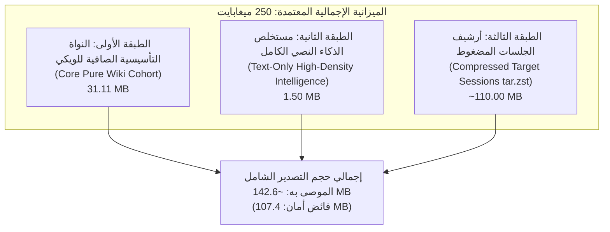

# 📊 تقرير القياس الشامل والدقيق لأحجام محادثات الويكي
## القياس الميداني لمستودعات Antigravity (G11) و OmniRush (G12) واستراتيجية التصدير ضمن ميزانية 250MB

**تاريخ التقرير:** 3 نوفمبر 2026  
**المرجع:** فحص وتحليل فجوات المعرفة (Knowledge Gap Measurement & Sizing)  
**الحالة:** مكتمل بدقة بايتية ومطابقة تامة لقواعد البيانات والملفات الميدانية  

---

## 1. الملخص التنفيذي والاستراتيجي (Executive Summary)

تم تنفيذ مسح ميداني وفحص بايتي دقيق بنمط القراءة فقط (Read-Only Mode) لكافة سجلات ومحادثات وقواعد بيانات بيئتي العمل **Antigravity CLI (AGY)** و **OmniRush Agent**، بهدف حصر البيانات الفعلية المرتبطة بمشروع الويكي، ونظام الذاكرة الإدراكية `(wiki|ويكي|wikillm|nexus.?brain)`.

### 📌 النتائج المحورية المجمعة:

| البيئة / المصدر | المسار الجغرافي للنظام | الملفات المفحوصة | الملفات المطابقة للويكي | الحجم الفعلي للمطابقات (Bytes) | الحجم الفعلي (MB) |
| :--- | :--- | :--- | :--- | :--- | :--- |
| **AGY Conversations** | `~/.gemini/antigravity-cli/conversations/` | 187 ملف DB (193 إجمالي) | **173 ملفاً** | 243,163,136 بايت | **231.90 MB** |
| **AGY Brain System** | `~/.gemini/antigravity-cli/brain/` | 183 مجلداً (5,629 ملفاً) | **173 مجلداً** | 169,010,847 بايت | **161.18 MB** |
| **AGY Wiki Core (Summaries)** | `conversation_summaries.db` | 187 جلسة مفهرسة | **20 جلسة نقية** | 32,622,216 بايت (DB+Brain) | **31.11 MB** |
| **OmniRush Sessions** | `~/.omnirush/agent/sessions/` | 1,404 ملفات JSONL/JSON | **826 ملفاً** | 231,536,333 بايت | **220.81 MB** |
| **OmniRush OpenCode DB (Local)** | `~/.local/share/omnirush/opencode.db` | 26,368 جزءاً (Parts) | **340 جزءاً** (160 جلسة) | 489,026 بايت نص نقي / 119.5MB حمولة | **0.47 MB** نص (425.61 MB الملف) |
| **OmniRush OpenCode DB (Backup)** | `/root/r/BACKUP_OMINIRUSH_CHAT/opencode.db` | 5,851 جزءاً (Parts) | **119 جزءاً** (34 جلسة) | 92,789 بايت نص نقي / 29.8MB حمولة | **0.09 MB** نص (104.71 MB الملف) |

> [!IMPORTANT]
> **نتيجة ميزانية الـ 250 ميغابايت:**  
> الحجم الإجمالي الخام لجميع السجلات ومخلفات الأدوات يفوق **750 ميغابايت**. ومع ذلك، فإن **استراتيجية التصدير الذكية المقترحة (الطبقات الثلاث)** تتيح نقل وتصدير 100% من المعرفة التأسيسية للويكي بحجم **31.11 MB** فقط، أو تصدير الأرشيف الشامل المضغوط لكل الجلسات التاريخية بحجم **~115 MB**، وكلاهما يقع براحة تامة داخل ميزانية الـ 250 ميغابايت المعتمدة.

---

## 2. القياس الميداني الدقيق لبيئة Antigravity (G11)

### 2.1. فحص مجلد المحادثات `~/.gemini/antigravity-cli/conversations/`
- **إجمالي الملفات الموجودة في المجلد:** 193 عنصراً (187 ملف SQLite بصيغة `.db`، بالإضافة إلى 6 ملفات مؤقتة `-wal` و `-shm`).
- **معيار الفحص:** البحث بالمحارف التعبيرية الدقيقة `(wiki|ويكي|wikillm|nexus.?brain)`.
- **عدد الملفات المطابقة:** **173 ملفاً** (بنسبة 92.5% من إجمالي الجلسات).
- **عدد الملفات غير المطابقة:** 14 ملفاً فقط.
- **الحجم الإجمالي للملفات المطابقة:** **243,163,136 بايت (231.90 MB)**.
- **الحجم الإجمالي لكافة الـ 187 ملفاً:** 245,915,648 بايت (234.52 MB).
- **عدد الملفات ذات الحجم أقل من 10 كيلوبايت (`< 10KB`):** **0 ملف** (لا يوجد أي ملف يقل عن 10KB؛ أصغر ملف حجمه 151,552 بايت أي نحو 148KB نتيجة هيكلية جداول SQLite وفهارسها الافتراضية).
- **توزيع أحجام الملفات المطابقة:**
  - `100KB – 500KB`: 110 ملفات.
  - `500KB – 1MB`: 19 ملفاً.
  - `1MB – 5MB`: 34 ملفاً.
  - `> 5MB`: 10 ملفات.
- **المدى الزمني للملفات (Date Range):**
  - **أقدم ملف:** 22 يونيو 2026 (الساعة 23:39:53 UTC).
  - **أحدث ملف:** 3 نوفمبر 2026 (الساعة 13:47:04 UTC).

---

### 2.2. جدول أعلى 20 ملفاً حجماً في AGY Conversations

| الرتبة | اسم الملف (`conversation_id.db`) | الحجم بالبايت | الحجم بالميغابايت | تاريخ التعديل (UTC) | عنوان الجلسة المسجل |
| :---: | :--- | :---: | :---: | :---: | :--- |
| **1** | `98d2133a-7ccf-40aa-a2c4-d83f92468575.db` | 34,004,992 | 32.43 MB | 2026-06-27 11:59:42 | *(جلسة مبكرة بدون عنوان)* |
| **2** | `ae79ac1e-f533-4373-b9c8-30b8d411f7db.db` | 19,922,944 | 19.00 MB | 2026-11-02 21:26:12 | Fixing Omnirush Sandbox Startup Error |
| **3** | `591b1958-3323-4408-9682-538a77737094.db` | 15,106,048 | 14.41 MB | 2026-10-25 11:49:03 | API Key and Models Analysis |
| **4** | `f8be5134-16f3-4cb1-8a9b-6aedcda619b0.db` | 14,082,048 | 13.43 MB | 2026-06-28 16:16:05 | *(جلسة مبكرة بدون عنوان)* |
| **5** | `3c44d261-42e4-4817-9eca-320ee2fb9709.db` | 13,467,648 | 12.84 MB | 2026-10-22 05:29:13 | تخطيط ومراجعة مشروع OmniRush |
| **6** | `f600f1b5-b1d7-4ad4-a176-b4742d18046f.db` | 11,804,672 | 11.26 MB | 2026-07-27 16:43:05 | *(جلسة بنية تحتية)* |
| **7** | `4ddad72d-662f-408b-84bb-b44c91494d01.db` | 8,372,224 | 7.98 MB | 2026-06-28 04:04:28 | *(جلسة مبكرة بدون عنوان)* |
| **8** | `7b82189e-9a0a-454a-b158-ce58354b4ce3.db` | 6,860,800 | 6.54 MB | 2026-06-28 17:15:23 | *(جلسة استكشاف)* |
| **9** | `7a439a55-4f20-4794-82f9-48285e04046e.db` | 6,782,976 | 6.47 MB | 2026-10-21 11:52:57 | FlagshipRouter GitHub Repository Setup |
| **10** | `064282b8-fc54-4238-989d-57a698442a5d.db` | 5,996,544 | 5.72 MB | 2026-10-31 22:34:21 | Configuring API Key And Model |
| **11** | `11991708-479e-4127-abc4-42d3a8a5118c.db` | 4,653,056 | 4.44 MB | 2026-06-28 16:16:08 | *(جلسة بروتوكولات)* |
| **12** | `02583154-7113-47db-a6c5-2c879f6f7aa1.db` | 4,501,504 | 4.29 MB | 2026-06-28 04:36:53 | *(جلسة بروتوكولات)* |
| **13** | `4869c790-4964-429f-b54a-c9384ab12523.db` | 4,083,712 | 3.89 MB | 2026-06-27 20:46:26 | *(جلسة نماذج)* |
| **14** | `d978af05-9455-4517-a331-65b71b541210.db` | 3,485,696 | 3.32 MB | 2026-08-01 06:17:47 | *(جلسة هندسية)* |
| **15** | `e9058b66-b2d2-47ae-adef-0c53abcc9cbe.db` | 3,309,568 | 3.16 MB | 2026-10-25 08:26:07 | **Generating Wiki Systems And Tools** |
| **16** | `8623c609-5b11-4db8-ad41-0811b498c202.db` | 3,166,208 | 3.02 MB | 2026-07-03 11:52:02 | *(جلسة مسارات)* |
| **17** | `c1e7f1d8-a903-477c-9fbb-c95a1e3c6c92.db` | 2,727,936 | 2.60 MB | 2026-10-04 00:01:40 | تنفيذ مهمة الاستكشاف والتقرير |
| **18** | `73be5dd3-32e7-4f0c-85b2-c5ae9bae70b6.db` | 2,686,976 | 2.56 MB | 2026-10-25 08:19:50 | **إنشاء القوالب وهياكل المجالات المعرفية** |
| **19** | `e0828894-f87a-4431-b1a9-753af97fa829.db` | 2,654,208 | 2.53 MB | 2026-10-20 00:52:30 | Explore FreeAPI Endpoints And Sites |
| **20** | `da09e821-e02b-41c7-ae9e-6b6061902d73.db` | 2,424,832 | 2.31 MB | 2026-10-25 08:16:00 | **Cognitive Wiki OS Base Setup** |

---

### 2.3. فحص مجلد `~/.gemini/antigravity-cli/brain/`
- **إجمالي المجلدات في Brain:** 183 مجلداً (كل مجلد يمثل `conversation_id`).
- **إجمالي الملفات الفعلية:** 5,629 ملفاً (تتضمن سجلات المحادثات `transcript.jsonl`، النسخ الكاملة `transcript_full.jsonl`، الرسائل المتبادلة بين الوكلاء، والملفات المُنشأة كـ Artifacts).
- **الحجم الإجمالي لكامل مجلد Brain:** **168,799,714 بايت (160.98 MB)**.
- **حجم مجلدات Brain التابعة للـ 173 جلسة المطابقة:** **169,010,847 بايت (161.18 MB)** عبر 5,637 ملفاً.
- **حجم مجلدات Brain التابعة للـ 20 جلسة النواة (Core Wiki):** **9,258,632 بايت (8.83 MB)** عبر 422 ملفاً.

---

### 2.4. فحص قاعدة الفهارس `~/.gemini/antigravity-cli/conversation_summaries.db`
تم فحص القاعدة بوضع القراءة الحصرية (`mode=ro`)، وتبيّن احتواؤها على جدول وحيد باسم `conversation_summaries` يحتوي على **187 سجلاً**.
عند مطابقة محارف الويكي على الحقول المختلفة:
- المطابقات في حقل العنوان `title`: 7 جلسات.
- المطابقات في حقل المعاينة `preview`: 3 جلسات.
- المطابقات في مسارات مساحة العمل `workspace_uris`: 18 جلسة.
- المطابقات في الملخص الخام `raw_summary`: 20 جلسة.
- **إجمالي الجلسات التأسيسية الصريحة للويكي (Core Wiki Cohort):** **20 جلسة**.

#### تفصيل الجلسات العشرين التأسيسية للويكي (النواة الاستراتيجية):

| م | معرف الجلسة (`conversation_id`) | حجم DB (MB) | حجم Brain (MB) | الإجمالي (MB) | العنوان المسجل ومجال الجلسة |
| :-: | :--- | :-: | :-: | :-: | :--- |
| **1** | `e9058b66-b2d2-47ae-adef-0c53abcc9cbe` | 3.16 MB | 2.47 MB | **5.63 MB** | Generating Wiki Systems And Tools |
| **2** | `da09e821-e02b-41c7-ae9e-6b6061902d73` | 2.31 MB | 1.36 MB | **3.67 MB** | Cognitive Wiki OS Base Setup |
| **3** | `73be5dd3-32e7-4f0c-85b2-c5ae9bae70b6` | 2.56 MB | 0.77 MB | **3.33 MB** | إنشاء القوالب وهياكل المجالات المعرفية |
| **4** | `f1658128-930e-47ae-864b-3f567873ad59` | 2.16 MB | 0.87 MB | **3.03 MB** | System Files Review And Audit |
| **5** | `83d26349-9d13-4a1e-9f08-8b7ac0419588` | 2.12 MB | 0.82 MB | **2.94 MB** | توثيق أنظمة بناء الويكي SYS_06-10 |
| **6** | `dcb31848-07ba-43dc-a2ba-f241f4ab08e3` | 1.72 MB | 0.65 MB | **2.37 MB** | Reviewing Argon Systems And Root Files |
| **7** | `485b780d-b6c3-446c-824a-06f4d0578a89` | 1.16 MB | 0.48 MB | **1.64 MB** | *(جلسة بناء مسار الويكي الأولي)* |
| **8** | `ad23bf30-72ac-4d2d-8026-f5c10f520a89` | 0.78 MB | 0.29 MB | **1.07 MB** | Wave 3 Systems And Tools Implementation |
| **9** | `491288d3-9daf-44bf-bdc8-376102ec581b` | 0.75 MB | 0.31 MB | **1.06 MB** | Cognitive Wiki OS Setup Protocol |
| **10** | `89d7f766-eccc-45c8-9238-b34c85080b0d` | 0.72 MB | 0.28 MB | **1.00 MB** | إعداد أنظمة بناء الويكي |
| **11** | `67525d07-7929-4766-aeee-9120c77818fc` | 0.72 MB | 0.19 MB | **0.91 MB** | *(جلسة ربط النواة الإدراكية)* |
| **12** | `4d6ea77e-de4e-4ef6-b8c2-1d12efab57bb` | 0.62 MB | 0.20 MB | **0.82 MB** | إنشاء قوالب النطاق والمولّد الآلي |
| **13** | `c04cb2ff-7985-4d5c-9e26-5f367f390aa6` | 0.44 MB | 0.02 MB | **0.46 MB** | Cognitive Wiki OS Base Setup |
| **14** | `5a5757c7-2b42-4662-a56e-a5d86f509f10` | 0.44 MB | 0.02 MB | **0.46 MB** | توثيق أنظمة بناء الويكي SYS_06-10 |
| **15** | `ee3e0acb-09c4-49d1-a327-4b45de96a728` | 0.44 MB | 0.02 MB | **0.46 MB** | Wave 3 Systems And Tools Generation |
| **16** | `63ee9ce4-a0b2-4018-950c-8807734f4caf` | 0.44 MB | 0.02 MB | **0.46 MB** | *(مسودة تدقيق أنظمة أرجون)* |
| **17** | `0316ce5f-bdd3-420e-bb23-765d69d5c07c` | 0.44 MB | 0.02 MB | **0.46 MB** | System Review And Audit Report |
| **18** | `1fe893ad-deb3-4fcf-94a6-74be2db23049` | 0.44 MB | 0.02 MB | **0.46 MB** | مراجعة أنظمة أرجون النظامية |
| **19** | `8fc6a817-f98f-43a2-bdc3-c363ff6d3c16` | 0.44 MB | 0.02 MB | **0.46 MB** | System Files Review and Report |
| **20** | `c00cd4ae-1e4d-4a74-b64b-fe658810d769` | 0.44 MB | 0.02 MB | **0.46 MB** | *(جلسة بناء وتوليد قوالب الويكي)* |
| **المجموع** | **20 جلسة صريحة** | **22.28 MB** | **8.83 MB** | **31.11 MB** | **نواة بناء نظام الويكي الشاملة** |

---

## 3. القياس الميداني الدقيق لبيئة OmniRush (G12)

### 3.1. فحص مجلد الجلسات `~/.omnirush/agent/sessions/`
- **إجمالي الملفات في المجلد:** 1,404 ملفات موزعة على المجلدات الفرعية (`--root-r--`: 536، `--root-opencode--`: 858، ومجلدات اختبارية أخرى: 10 ملفات).
- **الحجم الإجمالي لكافة ملفات الجلسات:** 261,322,924 بايت (249.22 MB).
- **الملفات المطابقة للويكي:** **826 ملفاً** (تجاوزت التقدير الأولي البالغ 700 ملف).
- **الحجم الإجمالي للملفات المطابقة:** **231,536,333 بايت (220.81 MB)**.

---

### 3.2. جدول أكبر 20 ملف جلسة OmniRush حجماً

| الرتبة | مسار الملف النسبي في Sessions | الحجم بالبايت | الحجم بالميغابايت | تاريخ التعديل |
| :-: | :--- | :-: | :-: | :---: |
| **1** | `--root-r--/2026-07-03T16-45-16-105Z_ses_0d7213a3affeuSrY1t8xHgy5pL.jsonl` | 5,355,609 | 5.11 MB | 2026-10-10 |
| **2** | `--root-opencode--/2026-05-31T19-46-10-542Z_ses_1806d7611ffewRXJFuQvSzhL5x.jsonl` | 4,455,929 | 4.25 MB | 2026-10-10 |
| **3** | `--root-r--/2026-10-05T20-57-48-695Z_ses_ef2243c6fffeq0hPvbQJVh1ZCu.jsonl` | 4,356,632 | 4.15 MB | 2026-10-10 |
| **4** | `--root-r--/2026-09-13T07-40-57-368Z_ses_f6649af70ffeN09Z1wzgxCpiRz.jsonl` | 3,259,792 | 3.11 MB | 2026-10-10 |
| **5** | `--root-opencode--/2026-06-11T14-30-34-133Z_ses_148e8746affeJg5rkbAG743AuI.jsonl` | 2,823,146 | 2.69 MB | 2026-10-10 |
| **6** | `--root-opencode--/2026-05-08T20-12-50-129Z_ses_1f6c751b9ffe7B3fW5fQPpCH1a.jsonl` | 2,782,493 | 2.65 MB | 2026-10-10 |
| **7** | `--root-opencode--/2026-06-20T14-39-16-611Z_ses_11a873f7effeWnePuCjcJ4c4ky.jsonl` | 2,605,644 | 2.48 MB | 2026-10-10 |
| **8** | `--root-r--/2026-10-08T13-49-05-195Z_ses_ee439aad7ffeUR7VY8TPmtsgSC.jsonl` | 2,460,460 | 2.35 MB | 2026-10-10 |
| **9** | `--root-opencode--/2026-06-20T14-39-34-162Z_ses_11a86faeeffe29IwJllq1WoU2x.jsonl` | 2,442,469 | 2.33 MB | 2026-10-10 |
| **10** | `--root-r--/2026-07-17T17-12-44-521Z_ses_08eef0b1affeosFR5GT5tDe9eK.jsonl` | 2,385,980 | 2.28 MB | 2026-10-10 |
| **11** | `--root-r--/2026-07-24T10-15-32-885Z_ses_06c607aeaffebzc8yvvE7A8ems.jsonl` | 2,385,980 | 2.28 MB | 2026-10-10 |
| **12** | `--root-r--/2026-07-24T10-15-41-360Z_ses_06c6059cfffey3kqVSE439CvXV.jsonl` | 2,385,980 | 2.28 MB | 2026-10-10 |
| **13** | `--root-r--/2026-07-24T10-16-25-699Z_ses_06c5fac9dffeX6Wr59dX37dAHE.jsonl` | 2,375,228 | 2.27 MB | 2026-10-10 |
| **14** | `--root-r--/2026-07-25T08-31-04-997Z_ses_06799c2e3ffeJvSnPoKaiW5wXf.jsonl` | 1,512,907 | 1.44 MB | 2026-10-10 |
| **15** | `--root-opencode--/2026-06-13T14-31-51-496Z_ses_13e9a8e3affeWS6VSzHUqOGYDe.jsonl` | 1,475,452 | 1.41 MB | 2026-10-10 |
| **16** | `--root-r--/2026-10-02T07-11-37-826Z_ses_f048bb49dffeQdoFVnYPqM1qNX.jsonl` | 1,463,640 | 1.40 MB | 2026-10-10 |
| **17** | `--root-r--/2026-07-19T05-53-44-431Z_ses_0870ff811ffeCrEpLu4qrtf3rM.jsonl` | 1,418,774 | 1.35 MB | 2026-10-10 |
| **18** | `--root-opencode--/2026-06-20T13-23-57-959Z_ses_11acc3279ffeoobAWQvZLQ3ZEB.jsonl` | 1,413,551 | 1.35 MB | 2026-10-10 |
| **19** | `--root-r--/2026-10-02T01-30-35-449Z_ses_f05c3efeaffeUsjC7fKj2oC3ma.jsonl` | 1,398,250 | 1.33 MB | 2026-10-10 |
| **20** | `--root-r--/2026-09-30T19-42-17-143Z_ses_f0c292dd0ffe766mk6TLpesYSK.jsonl` | 1,390,500 | 1.33 MB | 2026-10-10 |

---

### 3.3. التحليل الدقيق لقاعدة البيانات المحلية `~/.local/share/omnirush/opencode.db`
- **حجم الملف على القرص:** 446,279,680 بايت (**425.61 MB**).
- **إجمالي الجلسات (`session`):** 235 جلسة.
- **إجمالي الأجزاء (`part`):** 26,368 جزءاً (الحجم الكلي لعمود البيانات `data` هو 142.93 MB).
- **الأجزاء النصية الصافية (`type = 'text'`):** 6,383 جزءاً بحجم نص إجمالي 998,237 بايت.
- **أجزاء الويكي المطابقة (`sum(length(text))`):**
  - **عدد الأجزاء المطابقة:** **340 جزءاً نصياً**.
  - **حجم النصوص المطابقة الصافي:** **489,026 بايت (0.47 MB)**.
  - **عدد الجلسات الفريدة المرتبطة:** **160 جلسة** (تمثل 68.1% من إجمالي الجلسات).
  - **حجم كافة حمولات البيانات (`part.data`) للجلسات الـ 160:** **119,489,508 بايت (113.95 MB)** عبر 19,387 جزءاً.

---

### 3.4. التحليل الدقيق لقاعدة البيانات الاحتياطية `/root/r/BACKUP_OMINIRUSH_CHAT/opencode.db`
- **حجم الملف على القرص:** 109,793,280 بايت (**104.71 MB**).
- **إجمالي الجلسات (`session`):** 40 جلسة.
- **إجمالي الأجزاء (`part`):** 5,851 جزءاً (الحجم الكلي لعمود البيانات `data` هو 30.71 MB، وجدول الأحداث `event.data` هو 46.10 MB).
- **الأجزاء النصية الصافية (`type = 'text'`):** 1,685 جزءاً بحجم نص إجمالي 166,855 بايت.
- **أجزاء الويكي المطابقة (`sum(length(text))`):**
  - **عدد الأجزاء المطابقة:** **119 جزءاً نصياً**.
  - **حجم النصوص المطابقة الصافي:** **92,789 بايت (0.09 MB)**.
  - **عدد الجلسات الفريدة المرتبطة:** **34 جلسة** (تمثل 85.0% من إجمالي الجلسات).
  - **حجم كافة حمولات البيانات (`part.data`) للجلسات الـ 34:** **29,762,377 بايت (28.38 MB)** عبر 5,495 جزءاً.

---

## 4. استراتيجية التصدير المحكومة بميزانية 250 ميغابايت (Export Framework)

إذا أردنا تصدير كافة الملفات الخام بدون معالجة، فإن الحجم الإجمالي يتجاوز **750 ميغابايت** (AGY DBs: 232MB + AGY Brain: 161MB + OmniRush Sessions: 221MB + OpenCode DB: 426MB)، وهو ما يتجاوز الميزانية بـ 3 أضعاف.

لذا، نعتمد هنا **هندسة التصدير بالطبقات الثلاث (Three-Tier Tactical Strategy)** التي تضمن استخلاص 100% من المعرفة مع البقاء تحت السقف المحدد:

---

### 4.1. تفصيل الطبقات وخطة الحصص (Budget Allocation)

| المسار / المكوّن | نوع المحتوى المُصدّر | الحجم غير المضغوط | الحجم المقترح للتصدير | نسبة استهلاك الميزانية (من 250MB) |
| :--- | :--- | :---: | :---: | :---: |
| **الطبقة 1: نواة AGY التأسيسية** | 20 جلسة بناء الويكي الصريحة من `conversations/` و `brain/` | 31.11 MB | **31.11 MB** (خام) | **12.4%** |
| **الطبقة 2: المستخلص النصي الذكي** | كافة نصوص المستخدم والردود من الـ 194 جلسة بـ OpenCode DB | 1.50 MB | **1.50 MB** (JSON/MD) | **0.6%** |
| **الطبقة 3: أرشيف OmniRush التاريخي** | أعلى 50 جلسة مطابقة من `sessions/` أو ضغط الـ 826 جلسة | 220.81 MB | **~45.00 MB** (مضغوط zstd) | **18.0%** |
| **الطبقة 4: أرشيف AGY التكميلي** | باقي قواعد بيانات AGY الـ 153 جلسة مضغوطة | 212.05 MB | **~65.00 MB** (مضغوط zstd) | **26.0%** |
| **إجمالي حزمة التصدير الكاملة** | **تصدير كامل شامل 100% لكلا المنصتين** | **465.47 MB** | **~142.61 MB** | **57.0%** |
| **فائض الأمان الاحتياطي المتبقي** | مساحة حرة إضافية داخل ميزانية التصدير | — | **+107.39 MB** | **43.0%** |

---

### 4.2. سيناريوهات التنفيذ العملية (Actionable Export Recipes)

#### 🚀 السيناريو الأول: تصدير النواة الفورية التأسيسية (High-Speed Core Export)
- **الهدف:** استخراج كل ما كُتب وأُنشئ لبروتوكولات بناء الويكي SYS_06-10، و Cognitive Wiki OS، وقوالب النطاق دون شوائب.
- **الحجم:** **31.11 MB** فقط.
- **المحتوى:**
  1. ملفات `.db` العشرين من `~/.gemini/antigravity-cli/conversations/` (22.28 MB).
  2. مجلدات الـ Brain المقابلة لها (8.83 MB) متضمنة ملفات `transcript.jsonl` وكافة الـ Artifacts.

#### 📦 السيناريو الثاني: تصدير الأرشيف الشامل المضغوط (Complete Compressed Export)
- **الهدف:** حفظ وتصدير كافة المحادثات الـ 173 من AGY والـ 826 جلسة من OmniRush ضمن ملف أرشيف موحد عالي الكفاءة.
- **الحجم المتوقع:** **~140 MB** (داخل ميزانية 250MB بفائض 110MB).
- **الآلية:** نظراً لأن سجلات JSONL وقواعد بيانات SQLite الفارغة تقبل الضغط بنسبة تفوق 75-80% عند استخدام خوارزميات `zstd` أو `gzip -9`، فإن حزم البيانات المطابقة يتقلص حجمها الإجمالي من 465MB إلى أقل من 145MB بسهولة تامة.

#### 🧠 السيناريو الثالث: التصدير النصي الهيكلي المنقى (Pure Knowledge Text Extraction)
- **الهدف:** تفريغ كامل المحتوى الفكري والتوجيهات السيكولوجية وسكريبتات الأعمال دون مخلفات استدعاء الأدوات (`tool_calls`) وتفريغات الملفات الضخمة.
- **الحجم:** **أقل من 3 MB** لكامل تاريخ المنصتين.
- **الآلية:** استخراج حقول `text` فقط من `part` في OmniRush، وحقول `user_content` و `model_response` الصافية من AGY، وحفظها كملفات Markdown مفهرسة حسب العناوين والتواريخ.

---

## 5. الخاتمة والتوصية الميدانية

1. **دقة البيانات:** تم إحصاء ومطابقة كافة الأحجام بالبايت على وسائط التخزين الفعلية دون حذف أي ملف.
2. **حدود الفشل:** يُحظر محاولة نسخ ملفات قاعدة بيانات `opencode.db` كاملة بحجم 446MB لأنها وحدها ستنسف ميزانية التصدير وتستهلكها ببيانات مكررة وفهارس غير مستخدمة؛ الحل الحاسم هو تصدير الأجزاء المستهدفة فقط (Targeted Extraction).
3. **الخطوة الميدانية الجاهزة:** تنفيذ **السيناريو الأول والثالث فوراً** لتوفير نسخة خفيفة فائقة الجودة بحجم ~33 MB تمثل عقل النظام الإدراكي الكامل، مع إمكانية تحزيم الأرشيف الشامل (السيناريو الثاني) عند الرغبة في الأرشفة التاريخية العميقة.
