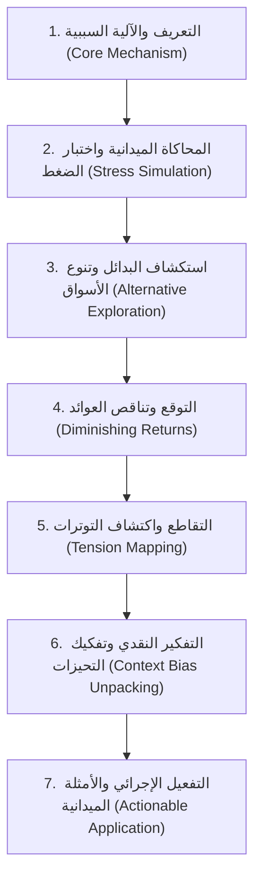

# SYS_06 — نظام استخراج المصطلحات والتعميق الإدراكي (Terms Deepening System)

```yaml
---
system_id: SYS_06
title: نظام تحويل الكلام لمصطلحات والتعميق الإدراكي السباعي
version: 2.0
status: active
type: operational_system
owner: moaz (zeyusmoaz@gmail.com)
dependencies:
  - SYS_01_CHARTER.md
  - SYS_04_THINKING_ENGINE.md
  - SYS_05_INGESTION.md
gates:
  - D04
  - D05
  - D06
---
```

---

## 1. الفلسفة ونوايا المالك: من النص الخام إلى الإدراك المعمّق

### 1.1 تعريف المصطلح التشغيلي
المصطلح في هذا النظام ليس مجرد كلمة مفرغة أو عنوان أكاديمي مجرد؛ **المصطلح هو جملة معرفية تحمل معنى تشغيلياً وسلوكياً مسحوبة من نص المصدر بموضعها وسياقها الكامل**. المصطلح يمثل وحدة بناء الفهم التي لا يمكن تفكيكها دون فقدان أثرها الإجرائي.

### 1.2 نية المالك الحرفية
جاء في توجيهات المالك الموثقة بنصها الحرفي الصريح:
> **المالك (AGY رسالة 15):** «وبعدين المصطلحات بيكون لها تعميق على فكرة احنا بناخد الكلام من ملف المصدر ونحوله لمصطلح والمصطلح بنعمله تعميق ابحث اكتر وافهم تانى الوضع اكتر».
> **المالك (GPT6 USER #33):** «ليه المصطلحات مش حصل لها تعميق كل مصطلح صغير جدا؟ ايه اللى بيحصل بالضبط وانت بتفكر ازاى بالضبط وبتفكر في ايه».

التعميق الإدراكي (Cognitive Deepening) هو الانتقال من الحفظ السطحي لكلمات المتحدث إلى سبر الأغوار السيكولوجية والهيكلية التي جعلت الفكرة تنجح، واستكشاف أين ومتى تنهار.

### 1.3 درس الويكي القديمة القاتل (15.7% فقط)
أثبتت مراجعة الويكي القديمة أن **15.7% فقط** من المفاهيم خضعت للتعميق الفعلي، بينما تحولت بقية المفاهيم (أكثر من 84%) إلى شظايا سطحية من سطرين أو ثلاثة أسطر، مجرد تكرار لكلمات المصدر دون فحص سببي أو وضع حدود للفناء. أدى ذلك إلى عجز النماذج اللاحقة عن توليد أنظمة مبيعات متماسكة، واضطرارها للهلوسة والتخمين.

---

## 2. منهجية التعميق عبر 7 خطوات (The 7-Step Deepening Protocol)

يخضع كل مصطلح مستخرج من أي مصدر لإجراءات منهجية التعميق المكونة من **7 خطوات** كاملة غير قابلة للاختزال:



### الخطوة 1: استخراج الميكانيكية الأساسية والتعريف التشغيلي (Definition & Core Mechanism)
- صياغة ما يقوم به المفهوم فعلياً على أرض الواقع، وفك شفرة السؤال الجوهري: *لماذا صاغ الخبير هذه الفكرة بهذا الشكل بالذات وما المحرك السيكولوجي الكامن خلفها؟*
- يجب أن تتجاوز الآلية مجرد الوصف العام لتبين الرابط السببي بين الفعل ورد فعل العميل أو السوق.

### الخطوة 2: المحاكاة الميدانية واختبار الضغط (Simulation & Stress Testing)
- إخضاع المصطلح لثلاثة سيناريوهات واقعية مضادة لاختبار صلابته:
  1. **سيناريو الرد الإيجابي المشروط:** كيف نتصرف دون حرق الصفقة؟
  2. **سيناريو التجاهل والبرود التام:** كيف يتحرك التكتيك حين لا يتفاعل الطرف الآخر؟
  3. **سيناريو الاعتراض المالي الصارم:** صمود المفهوم عند تصادم الميزانية أو التشكيك بالقيمة.

### الخطوة 3: استكشاف البدائل والتنوعات القطاعية (Alternative Exploration)
- تكييف المصطلح ليعمل عبر سياقات تسويقية متعددة:
  - صفقات الشركات الضخمة (B2B Enterprise) ذات الدورات الطويلة والمتعددة الأطراف.
  - صفقات الاستشارات والتدريب عالي التذكرة (B2C Coaching & High-Ticket).
  - الخدمات المحلية والتجارة الإلكترونية السريعة.

### الخطوة 4: التوقع وتناقص العوائد والحدود التراكمية (Predictions & Diminishing Returns)
- حساب نقطة التشبع التي يفقد عندها المصطلح فاعليته؛ متى يتحول التكرار من بناء مصداقية إلى مصدر إزعاج ينفر العميل؟ وتحديد الخط الدقيق لانقلاب الفائدة إلى ضرر تشغيلي.

### الخطوة 5: التقاطع واكتشاف التوترات الدلالية (Cross-linking & Contradictions)
- رسم موقع المصطلح في شبكة المفاهيم بالويكي، وتوثيق نقاط الاتفاق والتصادم مع آراء الخبراء الآخرين:
  - أين يتكامل هذا التكتيك مع مفاهيم أخرى مثل كسر الأنماط (Pattern Interrupt) وتأهيل العميل (Qualification)؟
  - ما التوتر القائم بينه وبين توصيات المدارس البيعية الأخرى؟

### الخطوة 6: التفكير النقدي وتفكيك التحيزات الخفية (Critical Thinking & Context Bias)
- استخراج الافتراضات غير المعلنة للمتحدث؛ هل نجح هذا التكتيك معه لأنه يملك سلطة مسبقة أو علامة تجارية قوية؟ هل ينطبق على مبتدئ يبدأ من الصفر بلا سمعة ولا عملاء سابقين؟ عزل التكتيك عن الظروف الشاذة لمنع خطأ الآيس بريك.

### الخطوة 7: التفعيل الإجرائي خطوة بخطوة مع ثلاثة أمثلة مكتوبة (Actionable Application & Examples)
- بناء خطوات تنفيذية محددة يباشرها الوكيل أو المستخدم فوراً، مرفقة بثلاثة نصوص حقيقية مصوغة بلهجة احترافية تثبت كيفية النطق أو الصياغة دون غموض.

---

## 3. بوابات القبول الرقمية D05 وD06 (من GATES_11)

### 3.1 معايير البوابات
تطبيقاً لميثاق الحوكمة، يخضع كل ملف مفهوم معمق لبوابتي الجودة الحارستين:

| البوابة | الاسم | الشرط الإلزامي | التصنيف (CASTRO) | أمر الفحص الآلي |
|---|---|---|---|---|
| **D05** | حدود الفناء | القسم موجود ولا يقل عن 40 كلمة تفصيلية | **حاجب (Blocking)** | `awk '/^## حدود الفناء$/{f=1;next}/^## /{f=0}f' "$f" \| wc -w` ≥ 40 |
| **D06** | الآلية السببية | شرح "لماذا وكيف يعمل" لا يقل عن 40 كلمة | **عالٍ (High)** | `awk '/^## الآلية$/{f=1;next}/^## /{f=0}f' "$f" \| wc -w` ≥ 40 |

### 3.2 لماذا توجد بوابتان منفصلتان (الوجود مقابل العمق)؟
القسم المكتوب في سطر واحد سطحي مثل: «حدود الفناء: لا شيء ينهي هذه الوصفة» أو «الآلية: التكرار يحقق النجاح» **يجتاز فحص `grep` البسيط لوجود العنوان ولكنه يُسقط فحص `awk` لكثافة الكلمات!**
لذلك تم تصميم منظومة البوابات لتجمع بين فحص الوجود الشكلي وفحص العمق الدلالي؛ غياب الشرح المعمق يسقط المفهوم تلقائياً ويمنع دخوله الفهارس أو اعتماده في الماسترز.

---

## 4. مثال تطبيقي موثق من مصدر حقيقي على القرص

- **المصدر الحقيقي المتحقق:** `/sdcard/Nexus_Brain/Nexus_Brain/brain/processed/1. The Biggest Problem in Sales (1).txt`

### 4.1 استخراج المصطلح الأصلي من المصدر
- **الموضع:** الدقيقة 02:15 إلى 03:40 من التفريغ النصي للملف أعلاه.
- **الاقتباس المصدري الحرفي:**
  > «حتة الـ pressure pressure pressure هتخلي العميل ينفر منك أصلاً... لو بتعمل pressure وحسيت إنه مرتبك أنت لا يمكنك التأمين بقوة أكثر من ذلك، يجب أن ترجع خطوة للخلف وتبدأ تريح العميل وتسأل أسئلة تفهم منها المشكلة، الموضوع مش من طرف واحد... فالترست (Trust) ذات نفسه هو أقوى حاجة تقفل بيها البيعة.»
- **المصطلح المعتمد:** `الضغط المتتالي يُنفر العميل ويفكك الثقة (Relentless Pressure Destroys Trust)`

### 4.2 نموذج التعميق وتطبيق بوابات D05/D06

```markdown
### الآلية (Mechanism) `{causal}`
يعمل التراجع التكتيكي عند شعور العميل بالارتباك على تفكيك جدار الدفاع النفسي التلقائي الذي يبنيه المشتري ضد محاولات الاستدراج والبيع القسري. عندما يرى العميل أن البائع لا يدفعه للإغلاق بأي ثمن، بل يتوقف ليسأل عن جذر المشكلة ويمنحه مساحة للتنفس والتفكير الهادئ، يتحول الإدراك من بيع استغلالي إلى استشارة تعاونية وشراكة تفاوضية متكافئة، مما يعيد بناء عنصر الثقة الذي يعد المحرك الأساسي لحسم الصفقات المعقدة في الأسواق المشبعة بالبدائل.

### حدود الفناء (Fence / Death-Limit) `{formula}`
تنهار هذه الوصفة التشغيلية بالكامل وتفقد فاعليتها حين يكون المنتج سلعة استهلاكية مجهرية منخفضة السعر تباع باندفاع لحظي (Impulse Buy) بلا دورة تفكير، أو عندما يكون العميل مماطلاً محترفاً يستغل إراحة البائع للتسويف والهروب من الالتزام المالي الواضح، ففي تلك اللحظة يتحول التراجع التكتيكي إلى تنازل يضيع الصفقة لصالح منافسين أكثر حسماً وإلزاماً للعميل بمواعيد إغلاق نهائية.
```

---

## 5. بروتوكول القياس والتدقيق المستمر

يتم تدقيق كافة ملفات المفاهيم المستخرجة بالأوامر التالية:

```bash
# 1. التحقق من وجود خطوات التعميق الإدراكي
grep -cE "7 خطوات|سبع خطوات" SYS_06_TERMS_DEEPENING.md

# 2. فحص استيفاء بوابة D05 (حدود الفناء >= 40 كلمة)
awk '/^### حدود الفناء/{f=1;next}/^### /{f=0}f' SYS_06_TERMS_DEEPENING.md | wc -w

# 3. فحص استيفاء بوابة D06 (الآلية >= 40 كلمة)
awk '/^### الآلية/{f=1;next}/^### /{f=0}f' SYS_06_TERMS_DEEPENING.md | wc -w

# 4. التأكد من صحة مسار المصدر الحقيقي
test -e "/sdcard/Nexus_Brain/Nexus_Brain/brain/processed/1. The Biggest Problem in Sales (1).txt" && echo "SOURCE_EXISTS"
```
