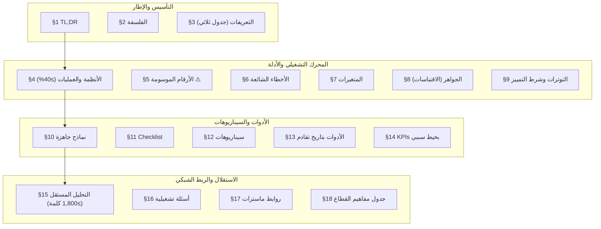

# SYS_07 — تشريح الماستر وعقد الأقسام الثمانية عشر (Master Anatomy & The 18-Section Contract)

```yaml
---
system_id: SYS_07
title: تشريح الماستر وعقد الأقسام الثمانية عشر الحاكم
version: 2.0
status: active
type: architectural_contract
owner: moaz (zeyusmoaz@gmail.com)
reference_document: /root/r/V3/00_CHARTER/FORMAT_MASTER.md
dependencies:
  - SYS_01_CHARTER.md
  - SYS_02_NAMING.md
  - SYS_03_TREE.md
  - SYS_06_TERMS_DEEPENING.md
gates:
  - domain_terms_complete
  - M_GATE
---
```

---

## 1. فلسفة الماستر والشرط الحاكم الأساسي

### 1.1 الماستر كـ "عقل تخصصي مجمع مسبقاً" (Pre-Compiled Domain Brain)
الماستر ليس مقالاً إنشائياً أو ملخصاً مكتبياً عادياً، بل هو عقل استراتيجي مجمع لنطاق معرفي متكامل. بدلاً من أن يبحث النموذج الذكي في مئات الملفات المتناثرة ويتعرض لتشتت السياق (Context Fragmentation)، يقرأ الماستر التخصصي الواحد في ثوانٍ، فيتحول فوراً إلى ممارس خبير يحيط بكافة أبعاد القطاع من المبدأ النفسي حتى السكريبت الحرفي وسيناريوهات الفشل.

### 1.2 شرط اكتمال مصطلحات المجلد قبل الماستر (`domain_terms_complete`)
**القاعدة الحرفية الصارمة للمالك (GPT6 USER #68):**
> «ولما تخلص استخراج مصطلحات كل المجلد الرئيسي مثلا كل مصطلحات المجلد بتاع الاوتريتش او مجلد المبيعات الرئيسي والمجلدات الفرعية اللى داخله وقتها تقدر تعمل ماستر غير كده مينفعش».

- يُمنع منعاً باتاً الشروع في صياغة أي ماستر (سواء كان ماستراً شاملاً أو ماستراً فرعياً مخصصاً) قبل استيفاء بوابة **اكتمال مصطلحات** النطاق (`domain_terms_complete`).
- يتطلب استيفاء هذا الشرط قراءة كافة مصادر المجلد الرئيسي والمجلدات الفرعية داخل لقطة التغطية (Snapshot)، واستخراج كافة المصطلحات والمفاهيم المرشحة ومراجعتها وتعميقها. أي محاولة لكتابة ماستر مبكر تُعد مخالفة صريحة لدستور الويكي وتلغى نتيجتها تلقائياً.

### 1.3 العقد وظيفي لا كمي (Functional vs Quantitative Contract)
- **الماستر الكبير (Major Master):** يغطي قطاعاً رئيسياً واسعاً، ويلتزم بكافة الحدود الرقمية القصوى المنصوص عليها في العقد (مثل §4 تشكل ≥40% من الكلمات، و§15 تتجاوز 1,800 كلمة).
- **الماستر الصغير / التخصصي (Specialized Sub-Master):** يغطي موضوعاً دقيقاً أو قطاعاً فرعياً محدود المصادر. في هذا الماستر، العقد **وظيفي لا كمي**؛ يجوز له استخدام عبارة «لا ينطبق» أو «دليل غير كافٍ في المصادر الحالية (Insufficient Evidence)» مع ذكر العلة الموضوعية صراحة.
- **مبدأ الصدق المعرفي:** إظهار الفجوة المعرفية وحدود المتاح في المصادر هو جزء جوهري من أمانة التوثيق وليس عيباً معمارياً؛ الحشو واختلاق أرقام أو توترات مصطنعة لإكمال الحدود الرقمية هو الجريمة المعرفية المرفوضة.

---

## 2. عقد الأقسام الثمانية عشر الحاكم (§1 إلى §18)

تلتزم كافة ملفات الماستر بالعقد المعماري الـ18 قسمياً المشتق من وثيقة الحوكمة المرجعية `FORMAT_MASTER.md` (وهو العقد الحاكم الرسمي، وليس نموذج الـ10 أقسام الملغى):



### §1 — الموجز التنفيذي (TL;DR)
- **الغرض:** وعد تشغيلي صارم يجعل القارئ يبدأ التنفيذ فوراً؛ ليس تلخيصاً مدرسياً.
- **المحتوى:** الأطروحة المركزية للقطاع + 3 عقائد تشغيلية حاسمة + ما سيتقنه الممارس في 60 ثانية.
- **الحدود:** 150 إلى 350 كلمة. أقل من ذلك مخل، وأكثر من ذلك تكرار للقسم §2.

### §2 — الفلسفة الحاكمة (Core Philosophy)
- **الغرض:** تفسير لماذا يعمل هذا المجال سيكولوجياً وتجارياً قبل الحديث عن أي تكتيك.
- **المحتوى:** 4 إلى 5 مبادئ جذرية؛ كل مبدأ مصحوب بتعليل سببي `{causal}` وسطر إلزامي يحدد **حدّ الفناء (Death-Limit)**. تنتهي ببيان الحد الذي يفصل الفلسفة عن النصيحة السطحية. (400-700 كلمة).

### §3 — التعريفات التشغيلية (جدول ثلاثي إلزامي)
- **الغرض:** إزالة الالتباس الاصطلاحي ومنع انزلاق المفاهيم المتجاورة.
- **المحتوى:** جدول ثلاثي إلزامي الأعمدة: `المصطلح` | `التعريف التشغيلي السلوكي` | `الفرق الحاسم عن الجار الملتبس`.
- **الحدود:** 8 إلى 15 مصطلحاً؛ ترك العمود الثالث فارغاً يسقط الجدول بالكامل.

### §4 — الأنظمة والعمليات (Systems & Operations)
- **الغرض:** الكثافة الإجرائية الكبرى التي تتيح العمل المستقل دون الرجوع لأي مرجع خارجي.
- **المحتوى:** 6 إلى 9 أنظمة متكاملة؛ لكل نظام: محفز التشغيل، الخطوات المتسلسلة، المدخلات، المخرجات، وحد الفناء الصريح.
- **الحدود:** **تشكل ≥ 40% من إجمالي كلمات الماستر** (تعادل ≥ 4,000 كلمة في الماستر الكبير المكتمل).

### §5 — الأرقام والإحصائيات الموسومة (Tracked Numbers & Metrics)
- **الغرض:** حصر كافة النسب والمقاييس الرقمية المذكورة في الماستر بقواعد واضحة.
- **المحتوى:** جدول: `الرقم` | `مصدره المباشر` | `صلاحيته الميدانية` | `وسم التوثيق`.
- **القاعدة الحاكمة:** أي رقم بلا منهجية علمية أو عينة مثبتة يوسم بـ **`⚠️ اجتهاد غير مسند: يُكتب ولا يُبنى عليه توصية`**.

### §6 — الأخطاء الشائعة وعلاجها (Failure Modes & Remedies)
- **الغرض:** تجنيب الممارس الوقوع في فخاخ التجربة بتكلفة مادية ومعرفية صفرية.
- **المحتوى:** 10 إلى 15 خطأ حقيقياً بالتمام؛ لكل خطأ ثلاثة حقول: `العَرَض الظاهر` | `العلاج الإجرائي` | `حدّ فناء العلاج` (أين ينكسر هذا الحل).

### §7 — المتغيرات والانقلابات (Contextual Variables)
- **الغرض:** توثيق متى تنقلب القواعد والأنظمة رأساً على عقب لا متى تستمر فقط.
- **المحتوى:** ≥ 5 محاور تبديلية أساسية (مثل: مرحلة السوق، حجم العميل، تذكرة السعر، القناة، الثقافة).
- **الشرط:** لكل محور تحديد صريح لما "ينقلب" وما "لا ينقلب"؛ يمنع منعاً باتاً أن تكون جميع المحاور متطابقة.

### §8 — الجواهر والاقتباسات الموثقة (Core Gems & Attributed Quotes)
- **الغرض:** تقديم الدليل الحرفي المباشر بلسان الخبراء وأصحاب التجارب.
- **المحتوى:** 15 إلى 25 اقتباساً نصياً حرفياً بين علامتي تنصيص « » مع ذكر اسم ملف المصدر الكامل؛ الاقتباس غير المنسوب لمصدر حقيقي على القرص يعد لاغياً.

### §9 — التوترات الحاكمة وشرط التمييز (Tensions & Disambiguation Rules)
- **الغرض:** استيعاب التعقيد الحقيقي للسوق بعيداً عن السذاجة الفكرية.
- **المحتوى:** 5 إلى 9 توترات حتمية تضم **الطرفين المتنازعين معاً** + **شرط التمييز الحاسم** الذي يحدد متى نرجح طرفاً على الآخر.
- **القاعدة الصارمة:** ممنوع الجمع الساذج وادعاء أن «كلاهما صحيح»؛ غياب شرط التمييز يسقط التوتر من كونه مفترق طرق معرفي.

### §10 — نماذج وقوالب جاهزة للتنفيذ (Battle-Tested Templates)
- **الغرض:** تمكين القارئ من نسخ وتطبيق نصوص ونماذج مثبتة فوراً.
- **المحتوى:** 4 إلى 6 نماذج تشغيلية مكتوبة بحروفها الكاملة داخل كتل برمجية (`code blocks`).
- **الشرط:** يجب أن يحتوي كل قالب على سطر **حدّ الفناء** مدوناً داخل الكتلة أو في سطرها الموالي مباشرة.

### §11 — قائمة التحقق التنفيذية (Operational Checklist)
- **الغرض:** تحويل العمليات المعقدة إلى نقاط فحص ثنائية لا تحتمل التأويل.
- **المحتوى:** 10 إلى 18 بنداً تنفيذياً مقسمة عبر ثلاث مراحل: (قبل البدء / أثناء التنفيذ / بعد الإغلاق).
- **الشرط:** صياغة بنود ثنائية حاسمة (تم الفحص بنجاح: نعم / لا)، وتجنب العبارات الفضفاضة مثل «تحسين الأداء».

### §12 — سيناريوهات المحاكاة الواقعية (Simulation Scenarios)
- **الغرض:** اختبار صلابة الماستر وقدرته على توجيه القرار الاستراتيجي تحت الضغط والقيود.
- **المحتوى:** 4 إلى 5 سيناريوهات محاكاة واقعية؛ كل سيناريو يبلغ **≥ 200 كلمة**، ويطرح قيود الموقف وخيارين تنفيذيين على الأقل، مع تبيان **التكلفة التي يدفعها صاحب القرار في كل خيار**، وبديل مرفوض معلل.

### §13 — مكدس الأدوات وتواريخ التقادم (Tool Stack & Deprecation Limits)
- **الغرض:** تزويد الممارس بالأدوات المعتمدة في السوق مع تحذير صريح من زوالها.
- **المحتوى:** 5 إلى 10 أدوات مستخرجة من المصادر الأصلية حصراً.
- **الشرط الإلزامي:** توثيق تاريخ الصلاحية وسنة الرصد لكل أداة؛ الأداة التي تفتقر لتاريخ رصد أو حد تقادم متوقع تُحذف من الماستر.

### §14 — خيط مؤشرات الأداء ومبدأ غودهارت (KPIs Causal Chain & Goodhart's Law)
- **الغرض:** قياس التقدم الحقيقي ومنع التلاعب بالأرقام المظهرية.
- **المحتوى:** 4 إلى 6 مؤشرات مربوطة بسلسلة سببية محكمة: `نقطة النهاية النهائية` ← `المؤشر الحاكم` ← `المؤشر التشخيصي` ← `الفعل البشري المباشر`.
- **الشرط:** تطبيق قانون غودهارت (Goodhart's Law) صراحة: عندما يتحول المقياس إلى هدف، يفقد قدرته على القياس.

### §15 — التحليل المستقل والتوليف الفكري (Independent Analytical Synthesis)
- **الغرض:** بلورة القيمة المضافة والرؤية المعرفية العميقة المتولدة من تقاطع المصادر.
- **المحتوى:** 7 إلى 10 أنماط استراتيجية مستنبطة + كشف فجوة معرفية صريحة في السوق + إطار عمل مقترح.
- **الحدود:** **≥ 1,800 كلمة** للمتن في الماستر الكبير؛ يقاس آلياً بأمر `awk`.

### §16 — الأسئلة التشغيلية والأجوبة الحاسمة (Operational FAQs)
- **الغرض:** حسم المعضلات الميدانية التي تواجه المنفذ أثناء التطبيق.
- **المحتوى:** 8 إلى 10 أسئلة تشغيلية عميقة (ليست أسئلة تعريفية سطحية)؛ طول الإجابة 80 إلى 200 كلمة مع إحالة صريحة للقسم الحاكم المعني.

### §17 — شبكة الروابط مع الماسترات الأخرى (Master Cross-References)
- **الغرض:** بناء شبكة الملاحة العابرة للقطاعات بين الكتب المعرفية الكبرى.
- **المحتوى:** روابط بصيغة `[[M_Slug]]` تحيل إلى ماسترات شقيقة أو قطاعات مجاورة (لا مفاهيم `C_` هنا).
- **الحدود:** ≥ 3 روابط صادرة حقيقية متحققة على القرص.

### §18 — جدول مفاهيم القطاع وروابط الويكيلينك (Sector Concepts Coverage Table)
- **الغرض:** تقديم الدليل القطعي على اكتمال التغطية المعرفية للنطاق بنسبة 100%.
- **المحتوى:** جدول شامل يضم **كافة** مفاهيم القطاع المستخرجة بلا استثناء، بصيغة ويكيلينك حقيقية `[[C_Slug]]` بجانب سطر تعريفي تشغيلي لكل مفهوم.
- **الحدود:** مطابقة تامة لعدد ملفات مفاهيم القطاع على القرص، مع صفر رابط وهمي أو مكسور.

---

## 3. أوامر التحقق والقياس الآلي للماستر

يخضع كل ملف ماستر للأوامر الرقابية الصارمة التالية للتأكد من سلامة بنيته:

```bash
# 1. فحص وجود شرط اكتمال المصطلحات والأقسام
grep -cE "domain_terms_complete|اكتمال مصطلحات" SYS_07_MASTER_ANATOMY.md

# 2. فحص اكتمال الأقسام الثمانية عشر دون نقص
for i in $(seq 1 18); do
  grep -q "^### §$i " SYS_07_MASTER_ANATOMY.md && echo "Section §$i OK" || echo "MISSING §$i"
done

# 3. التحقق من سلامة نمط الأوامر على ماستر مستقبلي
grep -c '^## §' <Master_File>                    # يجب أن يعطي 18 قسماً بالضبط
awk '/^## §4/{f=1;next}/^## §/{f=0}f' <Master_File> | wc -w   # يجب >= 4,000 في الماستر الكبير
awk '/^## §15/{f=1;next}/^## §/{f=0}f' <Master_File> | wc -w # يجب >= 1,800
```
