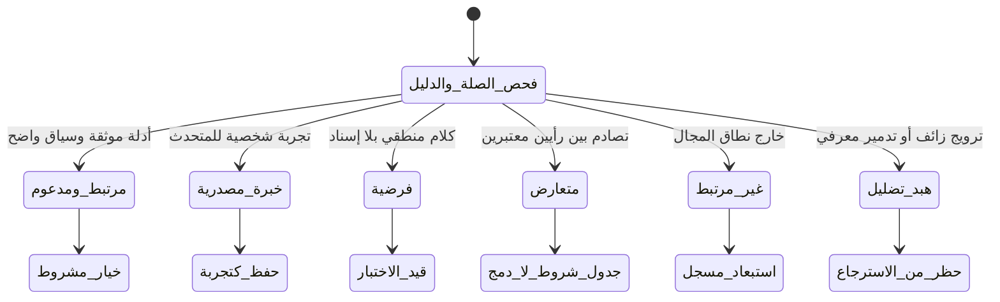

# SYS_08 — نظام تعددية الآراء وتوثيق السياق (Opinion Pluralism & Context Evaluation System)

```yaml
---
system_id: SYS_08
title: نظام تقييم الآراء وتعددية الرؤى وحوكمة التناقضات
version: 2.0
status: active
type: cognitive_system
owner: moaz (zeyusmoaz@gmail.com)
reference_skill: /sdcard/NEXUS_WIKI_SKILLS/opinion-context-evaluation/SKILL.md
dependencies:
  - SYS_01_CHARTER.md
  - SYS_04_THINKING_ENGINE.md
  - SYS_06_TERMS_DEEPENING.md
---
```

---

## 1. فلسفة تعددية الآراء ومنطق المالك

### 1.1 لا حكم صح/خطأ على الخبراء
في بيئات المبيعات وبناء الأعمال والتسويق، لا توجد "حقيقة مطلقة واحدة" تنطبق على كافة الحالات؛ ما ينجح مع شركة برمجيات تبيع لشركات عملاقة (Enterprise SaaS) يفشل حتماً مع مدرب يبيع خدمات أفراد (B2C Coaching). لذلك يحظر دستور الويكي على النماذج الذكية تقمص دور القاضي وإصدار أحكام ذاتية بالصواب أو الخطأ على كلام الممارسين الموثوقين.

### 1.2 نية المالك الحرفية الصريحة
> **المالك (GPT6 USER #40):** «هيكون فيه اراء كتير جدا لموضوع واحد فعايزين نختبر كل الاراء ونشوف اي واحد كويس مفيش حاجة اسمها راي صح او راي خطا لان كل واحد عنده راييه وده اللى نفع معاه فمش الحل نحذف خمس اراء ونترك واحد ونقول هو ده الصح بل نشوف كل واحد هينفع في اى موقف؟ وممكن نلاقي حاجة تانية انه راى غبي جدا واحد يكون بيهبد او مش له علاقة بالمجال اصلا فاهمنى؟ فده نحذفه تماما».
> **المالك (AGY رسالة 11):** «وانى واثق في الاشخاص اللى بيتكلمو وعارف انهم بيتكلمو من خبرة وكلامهم صح مش تراجع وتقول كلامهم صح او غلط لانه بالحالة دى هتختار حاجات معينة فقط والباقي هتتجاهله تماما فانت كل ملف هتدخله على الويكى لازم يدخل بكل محتواه بلا استثناء ومش تقول واحد صح و واحد خطأ».

الهدف هو بناء **أطلس مشروط للخيارات الإدارية والبيعية**، حيث يُربط كل رأي بالظرف الدقيق الذي يجعله فعالاً.

---

## 2. مصفوفة السياق السداسية لكل رأي (Context Matrix Fields)

لكل رأي أو تكتيك يُستخرج من المصادر، يتم توثيق مصفوفة سياق إلزامية تضم الحقول التالية:

| الحقل التقني | المعنى والدور الوظيفي | التفسير السيكولوجي والتشغيلي |
|---|---|---|
| `context` | سياق التجربة وحالة السوق | بيئة العمل التي نضج فيها الرأي (حجم المنافسة، تشبع السوق، ثقافة العميل). |
| `target` | الجمهور المستهدف والقناة | من المشتري بدقة؟ (مدير مشتريات B2B، مستهلك نهائي، مشتري اندفاعي). |
| `mechanism` | الآلية والرافعة النفسية | لماذا نجح هذا التكتيك؟ ما المشاعر أو الدوافع التي حركها (خوف، ثقة، طمع)؟ |
| `conditions` | شروط الصلاحية والعمل | ما المتطلبات التي يجب توفرها في المنتج أو البائع ليعمل الرأي بنجاح؟ |
| `counterconditions` | شروط الانهيار والفشل المضاد | **ما الظروف التي إن وجدت ينقلب الرأي إلى كارثة محققة وخسارة للصفقة؟** |
| `transferability` | القابلية للنقل والتعميم | هل التكتيك قابل للانتقال لقطاعات أخرى أم محصور بتجربة صاحبه وظروفه؟ |

يضمن حقل `counterconditions` تحصين النموذج والمستخدم من تعميم نصيحة خاصة وتطبيقها في بيئة مضادة تهلك الموارد.

---

## 3. مصفوفة القرار السداسية (The 6-State Decision Matrix)

عند معالجة أي رأي مستخرج، يُصنف حصراً وفق الحالات الست التالية:



1. **مرتبط ومدعوم (Relevant & Supported):**
   - الرأي يملك دليلاً أو نتيجة رقمية معلنة وسياقاً واضحاً. يُحفظ كـ **خيار مشروط** (Conditional Option) مع شروطه وسياقه.
2. **خبرة مصدرية وتجريبية (Empirical / Source Experience):**
   - نصيحة مبنية على تجربة شخصية لصاحب الفيديو أو المقابلة («أنا جربت هذا ونفع معي»). يُحفظ كـ **خبرة مصدرية** متميزة ولا يعمم كقاعدة مطلقة.
3. **بلا دليل مسند (Relevant but Unsupported):**
   - نصيحة جيدة ومنطقية ولكنها مجردة من الأرقام أو الحالات الموثقة. يُحفظ كـ **فرضية قابلة للاختبار الميداني** (Testable Hypothesis).
4. **متعارض مع رأي آخر (Conflicting Views):**
   - رأيان لخبيرين موثوقين يوصيان بإجراءين متناقضين للمشكلة نفسها. **يمنع الدمج القسري منعاً باتاً؛ يُنشأ جدول مقارنة للشروط** يوضح متى نأخذ بالأول ومتى نأخذ بالثاني.
5. **غير مرتبط بالنطاق (Irrelevant):**
   - كلام يدور حول موضوع خارج تخصص الويكي (مثل نصيحة طبية أو رأي في لعبة إلكترونية ورد في فيديو مبيعات). يُسجل له **استبعاد موثق** مع بيان سبب الخروج من النطاق.
6. **هبد صريح أو تضليل خارج المجال (Nonsense / Hallucination):**
   - ادعاءات خرافية تتناقض مع المنطق التجاري الصارم (مثل: «اضمن مليون دولار في أسبوع بلا عمل»). **يُستبعد تماماً من طبقة الاسترجاع والمعرفة الفعالة**، مع تسجيل بصمته وسبب الاستبعاد في سجل الشواذ لحماية الويكي.

---

## 4. قاعدة التناقض الجوهرية (Contradiction Resolution Rule)

### 4.1 تفكيك التناقض الظاهري
قبل أن يعلن النموذج وجود تناقض بين خبيرين، يجب إجراء فحص الأبعاد الأربعة:
1. **الجمهور المستهدف (Audience):** هل يخاطب أحدهما شركات كبرى بينما يخاطب الآخر مستهلكين أفراداً؟
2. **مرحلة القمع البيعي (Funnel Stage):** هل يتحدث الأول عن مرحلة جذب الانتباه الباردة (Cold Outreach) بينما يتحدث الثاني عن مرحلة الإغلاق النهائي والتفاوض (Closing)؟
3. **مستوى السعر وتذكرة البيع (Ticket Size):** هل الخدمة بقيمة $50 أم بقيمة $50,000؟
4. **القناة التسويقية (Channel):** هل التكتيك مخصص للبريد الإلكتروني البارد أم لمنصة تيك توك أم لمكالمة زووم مرئية؟

### 4.2 النتيجة الحتمية: توصيتان مشروطتان
- **إذا اختلف أي بعد من هذه الأبعاد الأربعة:** فهذا ليس تناقضاً فكرياً ولا يستدعي المفاضلة، بل هما **توصيتان مشروطتان** صحيحتان تماماً في سياقيهما المستقلين.
- **ممنوع الدمج في "متوسط زائف":** محاولة جمع «أرسل رسالة قصيرة جداً من سطرين» مع «أرسل خطاب مبيعات مفصلاً وطويلاً» ودمجهما في «أرسل رسالة متوسطة الطول» ينتج مسخاً مشوهاً يفقد ميزة الطرفين ويفشل في الحالتين! الصواب هو كتابة:
  - التوصية المشروطة الأولى: نصوص قصيرة عند مخاطبة الرؤساء التنفيذيين المشغولين على لينكد إن.
  - التوصية المشروطة الثانية: نصوص مفصلة ذات حجج متتالية عند بيع كورسات استثمارية على صفحات الهبوط.

---

## 5. مثال تطبيقي حقيقي موثق من القرص

- **المصدر:** `/sdcard/Nexus_Brain/Nexus_Brain/brain/processed/1. The Biggest Problem in Sales (1).txt`

### التوتر المرصود: أسلوب الضغط للإغلاق مقابل أسلوب التراجع الاستشاري
- **الرأي أ (أسلوب الضغط الكلاسيكي - أندريه تيت / المدارس القديمة):**
  - الادعاء: اضغط على العميل بقوة متتالية واحصره في الزاوية ليشتري الآن.
- **الرأي ب (أسلوب بناء الثقة المريح - المصدر أعلاه):**
  - الادعاء: الضغط المتكرر يجعل العميل ينفر ويهرب؛ تراجع خطوة وافتح حواراً لفهم المشكلة وبناء الثقة.

### مصفوفة الحل التشغيلي:
| البعد | الرأي أ (الضغط) | الرأي ب (التراجع وبناء الثقة) |
|---|---|---|
| `target` | مشترون اندفاعيون في بيئات أحادية الخيار | B2B ومشتريات خدمات معقدة متعددة البدائل |
| `mechanism` | استغلال الخجل اللحظي وتضييق الوقت | تحفيز الأمان النفسي وبناء شراكة استشارية |
| `conditions` | تذكرة منخفضة، صفقة سريعة بلا علاقة لاحقة | تذكرة مرتفعة، وجود منافسين كثر، عقد ممتد |
| `counterconditions` | **يفشل وينهار فوراً عند وجود منافسين؛ ينفر المشتري** | **يفشل مع المماطلين الذين يحتاجون حسماً زمنياً** |
| القرار النهائي | **توصيتان مشروطتان** بحسب طبيعة المنتج وتكلفة البديل في السوق |

---

## 6. أوامر الفحص والتحقق الآلي

```bash
# 1. التحقق من وجود حقل counterconditions وقاعدة توصيتان مشروطتان
grep -cE "counterconditions|توصيتان مشروطتان" SYS_08_PLURALISM.md

# 2. التأكد من توثيق حالات مصفوفة القرار الست
grep -cE "مرتبط ومدعوم|خبرة مصدرية|بلا دليل|متعارض|غير مرتبط|هبد" SYS_08_PLURALISM.md

# 3. التأكد من سلامة ملف المصدر الحقيقي
test -e "/sdcard/Nexus_Brain/Nexus_Brain/brain/processed/1. The Biggest Problem in Sales (1).txt" && echo "SOURCE_OK"
```
