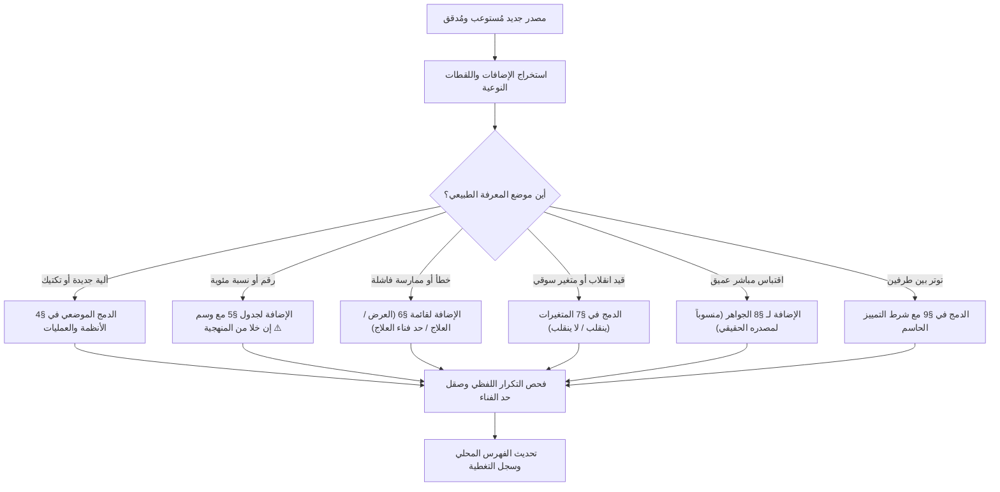

# SYS_09 — نظام التوليف التراكمي والتحديث الموضعي (Cumulative Synthesis & In-Place Update System)

```yaml
---
system_id: SYS_09
title: بروتوكول التوليف التراكمي الفوري والتحديث الموضعي للماسترز
version: 2.0
status: active
type: architectural_protocol
owner: moaz (zeyusmoaz@gmail.com)
reference_document: /root/r/V3/00_CHARTER/FORMAT_MASTER.md
dependencies:
  - SYS_01_CHARTER.md
  - SYS_05_INGESTION.md
  - SYS_07_MASTER_ANATOMY.md
gates:
  - no_duplicate_sections
  - in_place_integrity
---
```

---

## 1. الفلسفة المعمارية للتوليف التراكمي

### 1.1 مبدأ التوليف التراكمي الفوري (Immediate Cumulative Synthesis)
الماستر المعرفي ليس كائناً جامداً يُكتب مرة واحدة ثم يُغلق في تابوت زجاجي، بل هو نسيج إدراكي حي يتغذى باستمرار. **التوليف المعرفي يجب أن يكون عملاً تراكمياً فورياً يدمج المعارف الجديدة المستخرجة من كل مصدر جديد بمجرد قراءته وتدقيقه**. كلما دخل مصدر جديد إلى الويكي، تُفحص إضافاته وتُدمج فوراً في ملفات الماستر والمفاهيم المعنية دون تأجيل.

### 1.2 درس تجربة GPT-6 القاتل: كارثة بوابات التعليق
في تجربة سابقة مشؤومة مع نموذج GPT-6، تم ابتكار بوابات تعليق متشددة ومفرطة التعقيد (Suspension Gates) تشترط عدم لمس الماستر إلا بعد انتهاء معالجة وتدقيق كامل الملفات في لقطة شملت آلاف المصادر.
- **النتيجة الكارثية:** أدت بوابات التعليق البيروقراطية إلى شلل كامل وتجمد التدفق؛ حيث ظلت مئات الوكلاء معلقة تنتظر إشارات وهمية، ولم يُعالج سوى **3 ملفات فقط من أصل 2,541 ملفاً مصدرياً**!
- **الدرس المعماري الصارم:** التوليف التراكمي الحي هو الحامي الوحيد لاستمرارية المشروع؛ البوابات تُوضع لتوجيه جودة المدخلات، وليس كحواجز خرسانية تعطل تدفق المعرفة إلى الماستر.

---

## 2. قاعدة التحديث في المكان ومأساة الماستر ذي الـ36 قسماً

### 2.1 كارثة تكرار القسم الصامت (درس V3 الموثق)
عند بناء النسخة السابقة، ارتكب النموذج خطأ معمارياً فادحاً مسجلاً في ملف:
`/root/r/data/masters/Master_Brand_Identity_System.json`
حيث قام النموذج بإلحاق (Append) الأقسام الجديدة في ذيل الملف بدلاً من دمجها في مواضعها الصحيحة، فنتج ماستر مشوه يحتوي على **36 قسماً بدلاً من 18 قسماً**.
- **القياس الفعلي على القرص:**
  - تم نسخ وتكرار الأقسام §19 إلى §36 كنسخ شبه مطابقة للأقسام §1 إلى §18.
  - بلغت نسبة النصوص المكررة **53.5% من إجمالي كلمات الماستر** و**50.9% من إجمالي أسطره**!
  - تحول الملف إلى عبء معرفي مشتت يكرر الكلام دون أي إضافة حقيقية.

### 2.2 القاعدة الصارمة: كل قسم يحمل معلومة لا يحملها غيره
- **التحديث في المكان (In-Place Update):** عند ورود معلومة أو تكتيك أو استثناء جديد من مصدر حديث، يُفتح القسم المناظر لها داخل الأقسام الثمانية عشر (§1 إلى §18) وتُدمج الإضافة موضعياً مع صقل الشرح وحدود الفناء، وممنوع نهائياً فتح أقسام جديدة من نوع §19 أو إعادة كتابة عناوين مكررة.
- **اختبار فحص تكرار العناوين الإلزامي:**
  ```bash
  # فحص تكرار أقسام الماستر: يجب أن يكون الناتج فارغاً تماماً (Zero Duplicates)
  grep '^## §' "$file" | sed 's/^## §[0-9]*[: ]*//' | sort | uniq -d
  ```

---

## 3. خوارزمية التحديث التراكمي في المكان (In-Place Synthesis Algorithm)

عندما يستوعب الوكيل مصدراً جديداً يخص قطاعاً قائماً، يتبع المسار التالي:



### خطوات التنفيذ الإجرائية:
1. **التحديد الموضعي (Target Identification):** فرز الدليل الجديد وربطه بالقسم الحاكم المخصص له من بين الأقسام الـ 18.
2. **فحص عدم التكرار (Deduplication Check):** التأكد من أن التكتيك غير مذكور بمرادف آخر، فإن كان موجوداً أُضيف المصدر الجديد كمرجع تعزيزي أو أُضيفت الحالة الشاذة التي يمثلها.
3. **التطعيم المعرفي بحد فناء:** دمج الوصفة الجديدة داخل القسم مع كتابة حد فنائها الذي يحدد متى تسقط.
4. **تحديث الروابط والمفاهيم:** ربط أي مصطلح جديد ورد في الإضافة بالجدول الشامل في §18 وتوليد الرابط بصيغة `[[C_Slug]]`.

---

## 4. نموذج تطبيقي للتحديث التراكمي الموضعي

بافتراض وجود ماستر لنظام المبيعات `M_Sales_Closing_Architecture.md`:
- ورد مصدر جديد بعنوان: `/sdcard/Nexus_Brain/Nexus_Brain/brain/processed/1. The Biggest Problem in Sales (1).txt`
- يحمل المصدر خطأ شائعاً ارتكبه أحد البائعين (إسلام أشرف) بالسؤال الصادم للعميل عن مشاهدات فيديوهاته كتابة، مما فُسر كتحدٍّ واستفزاز أفسد التفاوض.

### إجراء التحديث في المكان (داخل القسم §6 من الماستر):
يُضاف الخطأ مباشرة داخل جدول أو قائمة الأخطاء الشائعة في §6 دون المساس بباقي الملف:

```markdown
### خطأ 11 — التحدي المكتوب وسؤال المشاهدات الاستفزازي `{causal}`
- **العَرَض:** كتابة سؤال نصي للعميل بصيغة: «هل أنت راضٍ عن أرقام المشاهدات الهابطة لقناتك؟».
- **التشخيص النفسي:** النص المكتوب يفتقر لنبرة الصوت الودية ويفسره العميل كإهانة شخصية وتحدٍّ مباشر يدمر الأمان النفسي.
- **العلاج:** استبدال النقد بسؤال استكشافي عن أهداف البيزنس: «ما الهدف الرقمي الذي تخطط للوصول إليه في الربع القادم؟».
- **حدّ الفناء:** هذا العلاج ينهار مع العملاء المتبجحين الذين ينكرون وجود أي خلل؛ هناك يلزم كشف الأرقام بمقارنة سوقية محايدة دون توجيه اتهام مباشر.
```

---

## 5. أوامر القياس والتحقق الصارم

```bash
# 1. التحقق من وجود مصطلح "تراكمي" في النظام
grep -c "تراكمي" SYS_09_CUMULATIVE_SYNTHESIS.md

# 2. فحص خلو النظام نفسه من تكرار العناوين
grep '^## ' SYS_09_CUMULATIVE_SYNTHESIS.md | sort | uniq -d

# 3. التأكد من وجود ملف المصدر الحقيقي المذكور في النموذج
test -e "/sdcard/Nexus_Brain/Nexus_Brain/brain/processed/1. The Biggest Problem in Sales (1).txt" && echo "SOURCE_FILE_VALID"
```
