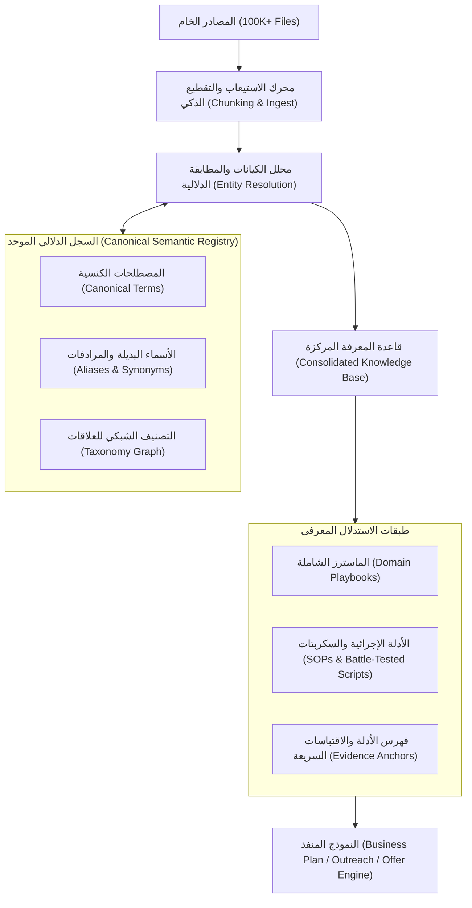

# وثيقة المعمارية القياسية لنظام Nexus LLM Wiki الموسع (100K+ Files)

**تاريخ التوثيق:** 2026-10-21  
**الهدف المعماري:** الانتقال من نظام البيروقراطية والملفات المتناهية الصغر إلى محرك استدلال وتشغيل معرفي فائق الكفاءة وقابل للتوسع غير المحدود.

---

## 1. جوهر الرؤية: محرك استدلال تنفيذي (Operational Intelligence Engine)

الويكي ليست مجرد أرشيف للمعلومات أو رف كتب رقمي للقراءة الترفيهية، بل هي **نظام تشغيل معرفي (Cognitive Operating System)** صُمم خصيصاً للنماذج اللغوية (LLMs) لتمكينها من إنجاز مهام واقعية معقدة:
- تصميم خطط أعمال واقعية (Business Plans).
- هندسة العروض التي لا تقاوم (Grand Slam Offers).
- بناء ماكينات الاستحواذ والتواصل البارد (Outbound Outreach Engines).
- قيادة مكالمات الاكتشاف وإغلاق الصفقات (Discovery & Closing SOPs).
- حل معضلات العمليات والتسعير والتسليم (Fulfillment & Operations).

---

## 2. تقييم نظام (Raw $\to$ Route $\to$ Candidate $\to$ Claims $\to$ Concepts $\to$ Masters)

### أ. الأصول الصحيحة (ما يجب الحفاظ عليه):
1. **عزل المصادر الخام (Raw Immutability):** حماية 2,541+ ملفاً خاماً من أي تعديل لضمان بقائها مصدراً أصلياً للحقيقة.
2. **سلسلة الأدلة الموثقة (Evidence Traceability):** ربط كل نصيحة أو قاعدة أو سكربت باقتباس حرفي ومصدر حقيقي لمنع هلوسة النماذج.
3. **التدرج الهرمي (Hierarchical Synthesis):** التدرج المنطقي من البيانات الخام إلى القواعد التنفيذية الشاملة.

### ب. العيوب القاتلة في تطبيق GPT-6 السابق (ما يجب استئصاله):
1. **الانفجار التخزيني والملفات المجهرية (Micro-File Explosion):** تفكيك كل جملة وادعاء إلى ملف JSON/MD مستقل. في بيئة تحوي آلاف الملفات، ينتج عن هذا مئات آلاف الملفات الصغيرة التي تشل الفهرسة وتستهلك مساحة القرص المحدودة (القرص ممتلئ بنسبة 100%).
2. **برزخ "المرشح" (Candidate Purgatory):** دخول العناصر في حالة `candidate` بدون آلية مؤتمتة لترقيتها، مما جعل 92 مصطلحاً و62 ادعاءً معلقة لأسابيع دون أن يولد ماستر واحد.
3. **المطابقة السطحية للألفاظ (Lexical vs. Semantic):** الاعتماد على عد الكلمات بدلاً من الفهم الدلالي للكيانات والأنظمة.
4. **العجز عن فض التناقضات (Contextual Blindness):** التعامل مع الآراء المتعارضة كأخطاء، بدلاً من تصنيفها حسب سياق السوق ونموذج العمل.

---

## 3. المعمارية الموسعة (The 100K-File Architecture)

### 1. المطابقة الدلالية ومنع التكرار (Entity Resolution & Deduplication):
- كل مصطلح يمثل **كياناً فريداً (Canonical Entity)** له معرّف ثابت.
- يمتلك كل كيان قائمة مرادفات موسعة (`aliases`):
  * *مثال:* كيان `Outbound_Cold_Outreach` يضم مرادفات: `cold email`, `linkedin dm`, `cold calling`, `direct outreach`.
- عند قراءة أي مصدر جديد:
  * إذا وُجد المفهوم، يتم **تطويره وتغذيته بأمثلة وسياقات واقتباسات جديدة (Concept Enrichment)** بدلاً من إنشاء ملف جديد.
  * إذا كان المفهوم جديداً كلياً، يُضاف للسجل الكنسي ضمن تصنيفه الهرمي الصحيح.

### 2. مصفوفة الصواب وفض التناقضات (Truth & Contextual Matrix):
المعرفة في البزنس محكومة بالسياق، وتُصنف على 3 مستويات:
1. **القوانين العالمية (Universal Laws):** ما أجمع عليه عمالقة المجال بالبيانات (مثل: حتمية وجود عرض واضح، إزالة المخاطرة، قياس مؤشرات الأداء الرئيسية).
2. **القواعد المشروطة بالسياق (Contextual Rules):**
   * سياق الـ High-Ticket B2B: دورات بيع طويلة، تركيز على الـ Discovery والاستشارات المخصصة، تسعير قيمي.
   * سياق الـ Low-Ticket / B2C: مسارات بيع مؤتمتة (Funnels)، تسعير سيكولوجي، محفزات سرعة وشراء 충동ي.
3. **مستوى الثقة في المصدر (Source Credibility Weight):** يوزن الدليل بناءً على عمق المصدر، وتطبيقه العملي، وتكراره عبر مصادر متعددة موثوقة.

### 3. التجميع الدفعي الموحد (Consolidated Domain Playbooks):
- بدلاً من آلاف الملفات المتناثرة، تُبنى **حقائب مجالات متكاملة (Domain Packs)**:
  1. **ماستر هندسة العروض والتسعير (Grand Slam Offer & Pricing Master)**
  2. **ماستر ماكينة الاستحواذ والتواصل (Outbound & Lead Generation Engine)**
  3. **ماستر مسار المبيعات وإغلاق الصفقات (Discovery, Sales Pipeline & Closing)**
  4. **ماستر نماذج الأعمال والعمليات (Business Models, Strategy & SOPs)**
- كل ماستر يحتوي على روابط سريعة (Anchor References) تقود للاقتباس والمصدر الأصلي دون الحاجة لتشتيت النموذج بملايين الملفات.

---

## 4. كيف تستخدم النماذج الويكي لبناء بزنس متكامل؟

عندما يُطلب من النموذج اللغوي: *"ابنِ لي خطة لبزنس B2B Automation Agency"*:
1. **الاسترجاع التشخيصي (Diagnostic Retrieval):** يسترجع النموذج فوراً ماستر نماذج الأعمال وهيكلية عروض B2B.
2. **صياغة العرض (Offer Synthesis):** يسحب قواعد التسعير القيمي، وآليات الضمان (Risk Reversal)، ومقاييس القيمة.
3. **تأسيس قنوات الاستحواذ (Acquisition Architecture):** يسحب سكربتات الإيميل البارد المعتمدة، وسلاسل المتابعة الخمس، ومعايير فحص جودة القوائم.
4. **أدلة التنفيذ والمبيعات (Closing & Fulfillment SOPs):** يسحب أسئلة مكالمة الاكتشاف التشخيصية وسيناريوهات تفكيك الاعتراضات الشائعة.
5. **النتيجة:** مخرج واقعي، احترافي، متماسك، خالٍ تماماً من الحشو والهلوسة.
